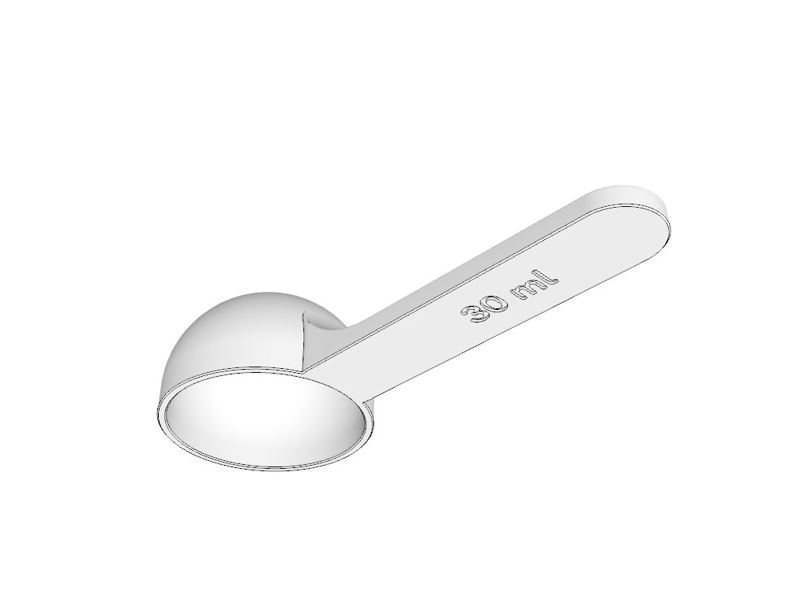
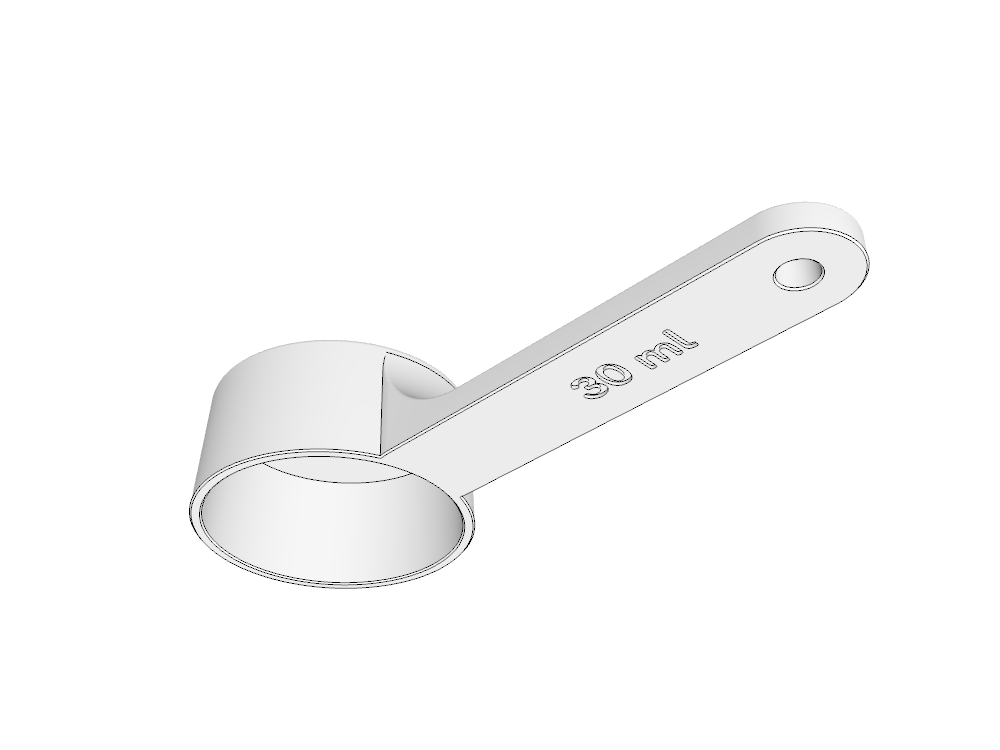
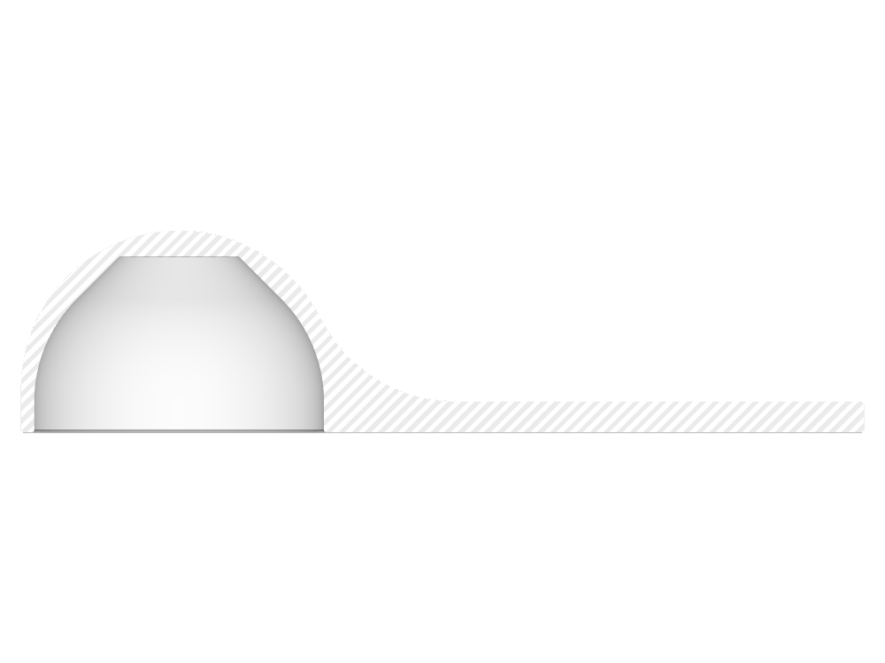

# Customizable scoop

A general-purpose Cadova scoop based on the coffee scoop model: a round-bottomed or tapered cylindrical bowl printed mouth down, reinforced handle, optional hanging hole, and optional engraved handle text.



The default round-bottomed model holds **30 ml** level to the rim and has a **44.2 mm** inner diameter and measures **128.2 × 48.2 × 30.5 mm**. The bowl opening sits on the bed. **The round variant's outside bottom stays a smooth, true hemisphere.** Overhang relief is applied only inside, using `Sphere.overhangSafe(.bridge)`: the spherical cavity transitions to 45° slopes and closes with a flat internal bridge. The default bridge span is **18.3 mm**. Capacity includes the straight opening and the relieved spherical cavity.

Choose **Cylindrical (tapered)** for a flat bottom and gently tapered walls. The taper is at most 3°, capped at a 10% radius reduction so tall, narrow bowls remain cylindrical. Depth adjusts to preserve the selected capacity. The exterior bottom edge is rounded, and side thickness is measured normal to the tapered wall. This variant still prints mouth down; its flat interior bottom bridges across the full reported bottom diameter.



The outer hemisphere's center sits slightly higher than the inner sphere's center. This preserves the requested minimum wall thickness around the inner bridge corners while keeping the exterior fully rounded.

The handle keeps its full width all the way to the bowl and meets it through a circular blend tangent to the outside surface and the flat grip. The curve revolves around the bowl axis, so it follows the bowl across the handle width. On the cylindrical variant, the blend shortens as needed to meet the tapered wall below the bottom's rounded edge. A **0.6 mm top fillet** follows the assembled brace and handle continuously. A **0.3 mm bottom chamfer** follows the completed bottom perimeter, including the brace, bowl rim and hanging-hole entrance.



## Customize

The generated browser customizer is in `Customizer/`. Serve it locally:

```sh
python3 -m http.server --directory Customizer 8000
```

Open <http://localhost:8000> to change the settings, preview the scoop, and download a 3MF. The generated customizer runs locally in the browser and includes its font.

To rebuild it after changing the source, with Swift 6.4.0 from swift.org installed:

```sh
./tools/build_customizer.sh
```

Pushing to `main` builds the customizer with the same script and publishes it on GitHub Pages (`.github/workflows/customizer.yml`). In the repository's settings, under Pages, set the source to GitHub Actions.

| Setting | Range / choices |
| --- | --- |
| Level capacity | 5–250 ml |
| Bowl shape | Round bottom (default) / Cylindrical (tapered) |
| Proportions | 0.5–2 inner depth ÷ inner diameter; default 0.6; deepened when necessary for handle attachment depth |
| Wall thickness | 1.2–4 mm minimum side and roof thickness |
| Handle length beyond bowl | 40–120 mm |
| Handle width | 12–30 mm, capped at the bowl's outside diameter |
| Handle thickness | 3–8 mm, limited to available rim or cavity depth |
| Hole diameter | 0 mm up to the handle width minus 3 mm on each side; default 0 means no hole |
| Handle text | Optional engraving on the bed-facing handle face; blank text omits it |
| Text size | 7–20 mm font size; default 7 mm; shrinks to fit the handle, but not below 7 mm |
| Engraving depth | 0.3–1.2 mm; default 0.6 mm |

A single hole-diameter control replaces the hole switch: 0 mm disables the hole. Text size and engraving depth appear when text is entered. The inner diameter follows from the capacity and proportions, so a bowl keeps its shape as the capacity changes. Very shallow proportions are deepened automatically, leaving a rim or cylindrical cavity at least 3 mm or twice the wall thickness high, whichever is larger. The handle-width control's maximum follows the selected shape's resulting outside bowl diameter, and geometry also clamps the width when passed directly in code. The customizer description contains only the resulting inner diameter, bowl height and bridge span, plus depth, handle-width or text-size adjustments when needed. Capacity is geometric; tessellation and edge treatments introduce small differences.

Fine surface quality is always used (1° minimum angle, 0.15 mm minimum segment size).

The build script applies the included Cadova 1.2 preview-precision patch to its temporary dependency checkouts, builds the customizer, then restores those checkouts. It keeps coordinates in Float64 until sharp edges have been classified, matching Cadova Viewer. WebGL vertex buffers remain Float32. This prevents thin, smooth triangles from acquiring false outlines when their coordinates are rounded too early. The reader also accepts existing version-1 previews.

Check that regression, preview compatibility, real creases and the actual WASM output with:

```sh
node --no-warnings --experimental-loader ./tools/three-loader.mjs tools/test_customizer_edges.mjs
node --no-warnings tools/test_customizer_shapes.mjs
```

## Build locally

```sh
swift run scoop
swift run scoop --examples
swift test
```

The first command writes `Models/scoop.3mf`. The second also generates an engraved 30 ml example, a 5 ml scoop, a 100 ml scoop, cylindrical examples including a small bowl with a wide handle, and a 6 mm hanging-hole example with engraved text. To change native defaults, edit the `@Parameter` values in `Sources/main.swift`. The geometry and derived dimensions live in `Sources/Scoop.swift`; text layout lives in `Sources/HandleLabel.swift`.

Print as generated, with the **bowl opening on the bed** and the outside bottom upward. The handle also rests on the bed. The exterior contracts upward. The round interior follows 45° slopes near its roof, then bridges across the reported span. The cylindrical interior has a wider flat bridge; use the slicer's bridge settings for the closing surface. Text is engraved 0.6 mm deep into the bed-facing handle face, which becomes the visible upper face when the scoop is flipped for use. It is mirrored in print coordinates so it reads correctly from that side, and right-aligned against the hanging hole (or the handle's rounded end without one). Raised lettering is not offered. The customizer preview shows the scoop flipped the way it is used; downloaded files keep the print orientation.

Tests measure both shapes' cavity capacity at four size combinations, check the mouth-down orientation, closed dome and spherical interior by ray casting, verify that the hole removes material, and check connected geometry for lettering and a small-capacity scoop. Layer comparisons below the final bridge check the 45° overhang limit. Separate tests verify the hemispherical outside, the flat bridge and the minimum roof material at the bridge corners, including a large, thin-walled configuration. Cylindrical checks cover flat inner and outer bottoms, taper, normal wall thickness, cavity enclosure and connected geometry at small, large, narrow and thin-walled settings.

Handle checks measure the bevel beneath the brace and at the hole entrance and verify the continuous top fillet into the flat grip on both bowl shapes. Other checks confirm that an oversized handle cannot exceed the bowl width.

Also verified with `cadova-viewer info` and actual viewer renders: isometric views from both sides, an underside view into the opening, sections through the hemispherical outside, inner bridge, neck, hanging hole and engraving, plus engraved, 5 ml, 100 ml and cylindrical variants. Viewer renders are saved as `Previews/cadova-*.png`.

Handle lettering uses Fredoka at weight 550, matching `qr-code-cadova`. The default and minimum font size is 7 mm, designed around a 0.4 mm nozzle. Size and placement come from the font, not from the particular letters, so labels with and without tall letters line up the same way. Small grooves and counters still depend on the selected text, slicer settings and first-layer setup; review them in the slicer. Long labels are shrunk to fit between the bowl, the hole and the handle edges, and the customizer reports the fitted size. Text that doesn't fit even at 7 mm is left out, and the customizer asks for shorter text. The bundled font is distributed under the SIL Open Font License; see `Sources/Resources/Fredoka-OFL.txt`.

The default engraved example was also sliced with PrusaSlicer 2.9.6 using a 0.4 mm nozzle, 0.2 mm layers and variable extrusion widths around a nominal 0.45 mm. The first-layer toolpaths retain the lettering and its enclosed islands. [View the first layer from the bed-facing side](Previews/slicer-engraving-first-layer.png). The slicer separately flags long bridging extrusions at the bowl roof; the reported bridge span still needs suitable bridge settings.
