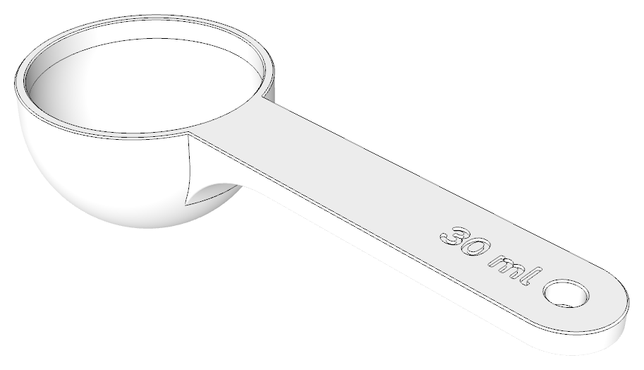

# Customizable scoop

A parametric scoop for 3D printing, made with [Cadova](https://cadova.org). Choose the capacity, round or flat-bottomed bowl, proportions, handle size, an optional hanging hole and engraved text. It prints mouth down without supports.

**[Open the customizer](https://tomasf.github.io/scoop/)**
